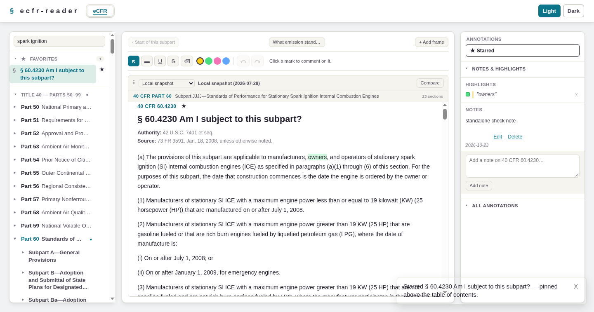
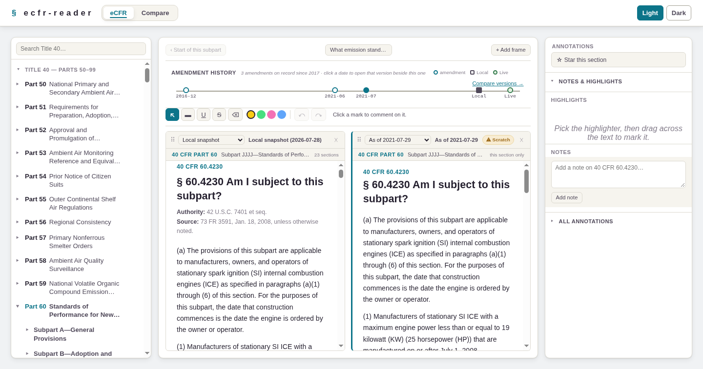
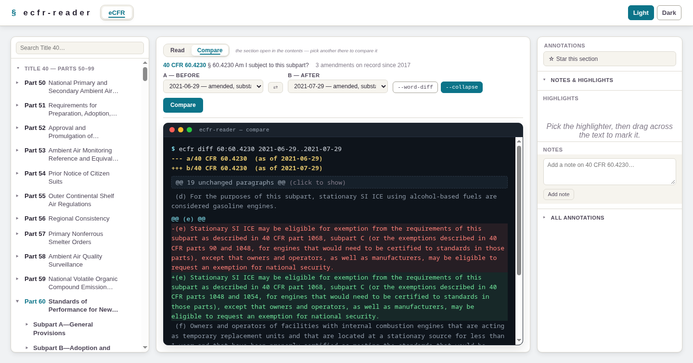

# ecfr-reader

A local-first reader for Title 40 of the Code of Federal Regulations. It
fetches the eCFR's XML once, keeps it in a SQLite file on your machine, and
gives you a reader that works offline: a table of contents you can star,
full-text search, up to six reading frames side by side (the local
snapshot, live ecfr.gov, or any past version), a Compare tab in the same
pane that prints the difference between two versions as a git-style diff, highlights with
comments, notes, a check that tells you when ecfr.gov has published a
newer issue, and a Dockets tab that catalogs the regulations.gov record
behind a rule — every document in a docket with its PDFs and spreadsheets.

State-level regulations may be added in the future where practicable.







Built for air-permitting work (Title 40, parts 50–99: the Clean Air Act
programs), but the corpus tools take any part range in Title 40.

## Quick start

Python 3.10 or newer, with an `sqlite3` that has FTS5 (every python.org,
distro and uv-managed interpreter does).

```bash
git clone https://github.com/stackheight/ecfr-reader.git
cd ecfr-reader
python3 -m venv .venv && . .venv/bin/activate
pip install -r requirements.txt

export ECFR_CONTACT=you@example.org      # who to reach about your requests (see below)
python3 -m ecfr_reader fetch             # ~95 MB of XML, 50 parts, a couple of minutes
python3 -m ecfr_reader import            # builds data/ecfr.db (~170 MB), about 20 s
python3 -m ecfr_reader serve             # http://127.0.0.1:5000 or http://localhost:5000
python3 -m ecfr_reader serve --port XXXX # serve on alternative port
```

`python3 -m ecfr_reader status` says what the data directory holds.
`pip install -e .` adds an `ecfr-reader` command that does the same.

On **Windows** (PowerShell, or PyCharm's terminal) the same steps read:

```powershell
py -m venv .venv; .venv\Scripts\activate
pip install -r requirements.txt
$env:ECFR_CONTACT = "you@example.org"       # cmd.exe: set ECFR_CONTACT=you@example.org
python -m ecfr_reader fetch
python -m ecfr_reader import
python -m ecfr_reader serve
```

Run the commands from the project folder (the data directory is `.\data`
under wherever you run them; in PyCharm, a run configuration's working
directory). Stop `serve` before you `import`: the import swaps the
database file into place, and Windows will not replace a file another
process holds open. The test suite runs on Windows in this repository's
GitHub workflow.

## What the reader does

- **Table of contents.** Parts 50–99, each expanding to its subparts,
  appendices and loose sections. Star any part, subpart or section; the
  stars pin above the tree.
- **Reading units.** You read a subpart (or an appendix, or a part's loose
  sections) as one scrolling page, not a section at a time. Previous / next
  unit at the top and bottom. Click a subpart's heading in the contents to
  open the whole subpart as the thing you are working on: the history rail,
  the dated frames and Compare then cover every section of it at once;
  click a section to narrow back to one. The caret beside the heading just
  shows or hides its sections.
- **Frames.** One to six side-by-side frames, each on a source: the local
  snapshot (the eCFR as it stood on the day `fetch` ran — the eCFR has no
  releases, it is amended continuously), live text fetched from ecfr.gov,
  or the text as of any amendment date on the rail. A frame's source menu
  lists exactly what the rail shows. Drag to reorder.
- **Amendment history.** A labelled rail across the top of a section:
  every date ecfr.gov amended it (its history starts 2017), with Local and
  Live on the same rail. Click a date (or pick it from a frame's source
  menu) to open that version in a new frame beside the one you are reading;
  its text is fetched from ecfr.gov once and kept in the local cache, and
  the snapshot itself never changes. With a whole subpart open the rail shows
  every date any of its sections changed, and a dated frame holds the whole
  subpart as it stood that day (one request to ecfr.gov, like Live).
- **Compare.** The reading pane's second tab (Read | Compare), fed by
  the same contents sidebar. Pick two versions of the open section, A
  (before) and B (after), and the difference prints into a mock terminal
  as a git-style unified diff: a hunk per changed paragraph, named by its
  enumerator ("(e)"), runs of unchanged paragraphs folded to one line
  (click to show), `--word-diff` for the changed words marked inside each
  paragraph. The paragraph stays the unit of the diff — it is what the
  CFR cites; tables are flagged whole. A whole subpart diffs section by
  section like a multi-file diff, with sections added or removed between
  the two dates shown against `/dev/null` and unchanged ones folded. A
  comparison is a link you can send: `#ecfr/compare/60:60.4230/A..B` for a
  section, `#ecfr/compare/60/OOOOb/A..B` for a subpart.
- **Marks.** A toolbar in the PDF-editor idiom: highlight in four colours,
  underline, strike, an eraser, undo / redo, and a comment on any mark.
  Marks on live frames are scratch and never saved. A mark whose text has
  drifted after a re-import is listed as orphaned rather than guessed.
- **Notes** on any section, and a panel that lists every note and mark at
  the scope you choose: this section, its subpart, its part, or all of
  Title 40.
- **Search.** Full text across the corpus (SQLite FTS5), with snippets.
- **Updates.** The dashboard checks ecfr.gov for a newer issue of your
  parts and lists what changed. It only tells you; refreshing is the two
  commands above, run again.
- **Dockets.** A second tab, beside eCFR in the header: the regulations.gov
  docket behind a rule. Add one by ID (it is printed in every Federal
  Register notice) or by searching EPA's dockets, and a sync catalogs it:
  the docket record, every agency document — proposed rule, final rule,
  notices, the hundreds of supporting memos, meeting materials, reports
  and data files — and each document's files with format and size. Facet
  by type, subtype and format (`xlsx`, `pdf`, …), search titles and
  abstracts, open a document to see its abstract, Federal Register citation,
  comment count and files. See [Dockets](#dockets) for how files are handled.
- **Light and dark themes.**

Your notes, marks and stars live in `data/annotations.db`. That is the one
file worth backing up; everything else in `data/` is derived and can be
rebuilt from ecfr.gov.

## Dockets

The Dockets tab talks to the [regulations.gov v4 API](https://open.gsa.gov/api/regulationsgov/),
which needs a free api.data.gov key: one form at https://api.data.gov/signup/,
then `export REGSGOV_API_KEY=…` before `serve`. A key allows 1,000
requests an hour.

**A sync is the catalog step, not a download.** It fetches the docket record
(one request), lists its documents type by type (a few requests, 250 a
page), then asks for each document's detail (one request per document; the
list does not say what files a document has) for its abstract, Federal
Register citation and file list, and counts the public comments on each
rule. A large EPA rulemaking docket is 700 or so documents, so the sync
paces itself, saves as it goes, keeps 25 requests of the hour unspent for
browsing, and when the quota runs out it stops and **resumes from the rows
still pending** when you press Sync again (or on the hour). Public comments
are counted, not catalogued: a big docket has tens of thousands.

**Files are a separate step, because the file host serves browsers only.**
`downloads.regulations.gov` answers 403 to anything that is not a browser,
and this tool does not pretend to be one. So in the catalog every file is
listed with its format and size, **Open** is a real link to the file in a
new tab, **Keep a copy** makes one honest server-side attempt (the formats
in `REGSGOV_AUTO_PULL`, data files by default, are tried during a sync),
and the **drop zone** on a document files a download you made in the
browser into `data/dockets/<docket>/<document>/`, matched to the catalogued
file it is by format and size. Kept copies open from the app and the
"only documents with a copy kept here" facet finds them.

**Diffing a proposal.** A proposed rule's regulatory text is not in the
eCFR (only final rules are) and often not in the Federal Register notice
either: EPA posts it in the docket as a "Redline/Strikeout" memo, a DOCX
or a PDF. Keep that file, then press **Use as proposed text** on it. The
tool reads a redline as two texts, the struck runs being the *before* and
the inserted runs the *after*, finds the sections and amendatory
instructions ("Revising paragraph (b)(1)"), keys every paragraph by its
CFR enumerator path, and composes **the subpart as it would read**: revised
paragraphs replaced, new ones inserted in enumerator order, struck ones
removed, everything unmentioned carried over unchanged, and anything that
fits nowhere listed as *unmatched* rather than dropped. The result is a
source like any dated version: **Proposed — <title>** in a frame's source
menu and in the Compare tab's pickers, so `local..proposal:3` prints the
proposal against your snapshot as a git-style diff, and **Base of
proposal** diffs the text EPA marked up against your snapshot, with the
share of base paragraphs that match reported, which tells you whether EPA
redlined the same text you have. DOCX is read exactly from Word's tracked
changes and strike/underline formatting; PDF is read by geometry, pairing
the drawn strike and underline lines with the characters under them, and
the counts of struck and inserted spans are reported so you can judge it.
A file with no detectable markup is read as clean text, by paragraph
(`amend`) or whole sections (`replace`).

The same from the command line: `ecfr-reader dockets add EPA-HQ-OAR-2021-0317`,
`dockets sync <ID>` (resumes), `dockets list`. The catalog is
`data/dockets.db`, separate from the corpus (rebuilt in seconds) because it
costs hundreds of requests to rebuild, and from `annotations.db` because it
holds nothing you wrote.

## Configuration

| Variable              | Default                 | Meaning                                                                                                                                                                                                        |
| --------------------- | ----------------------- | -------------------------------------------------------------------------------------------------------------------------------------------------------------------------------------------------------------- |
| `ECFR_CONTACT`        | unset                   | Required by `fetch` and by the live / update features. An email address or URL that goes into the User-Agent so the eCFR operators can reach whoever is making the requests. The reader itself never needs it. |
| `ECFR_DATA_DIR`       | `./data`                | Where the XML, the corpus and your annotations live. Relative to the directory you run from.                                                                                                                   |
| `ECFR_DB`             | `<data>/ecfr.db`        | The corpus file.                                                                                                                                                                                               |
| `ECFR_ANNOTATIONS_DB` | `<data>/annotations.db` | Your notes, marks and stars.                                                                                                                                                                                   |
| `REGSGOV_API_KEY`     | unset                   | Required by the Dockets tab: a free [api.data.gov](https://api.data.gov/signup/) key sent as `X-Api-Key` on every regulations.gov request. `DEMO_KEY` is never substituted (30 requests an hour, shared by everyone behind your address). |
| `REGSGOV_AUTO_PULL`   | `xlsx,xls,csv,zip`      | File formats a docket sync tries to download itself; `none` to catalog only. |
| `ECFR_DOCKETS_DB`     | `<data>/dockets.db`     | The docket catalog and the proposals read from its files. Kept files go under `<data>/dockets/`. |

`fetch --parts 60,63` or `--parts 50-52` narrows the corpus; `--date
YYYY-MM-DD` fetches a past issue; `--force` refetches parts already on
disk (a fetch is otherwise resumable). The parts in scope are remembered
in `data/dataset_state.json`.

## Being a good client of ecfr.gov and regulations.gov

The eCFR versioner API (https://www.ecfr.gov/developers) is a public
service. This tool identifies itself with your `ECFR_CONTACT`, waits 1.5 s
between parts, backs off for 30 s on a 429, and makes at most two requests
per update check. Please keep it that way.

regulations.gov is another: every request carries your own api.data.gov
key and an identifying User-Agent, a sync waits 0.6 s between requests and
stops with 25 of the hour's 1,000 unspent, a docket search is cached for a
day, and the file host's refusal of non-browser clients is respected, not
worked around.

## API

Everything the page uses is plain JSON under `/api/ecfr/`:

| Route                                                     | What                                                       |
| --------------------------------------------------------- | ---------------------------------------------------------- |
| `GET /status`                                             | snapshot date, parts, section count, the last update check |
| `GET /toc`, `GET /toc/<part>`                             | the parts; one part's subparts and sections                |
| `GET /unit?part=&subpart=` (or `&appendix=`, or neither)  | every section of one division, with its text blocks        |
| `GET /unit/live?part=&subpart=`, `GET /section/live?key=` | the same from ecfr.gov, as of its current issue            |
| `GET /section/versions?key=` | the dates ecfr.gov amended the section (cached a day; `?force=1`) |
| `GET /section/at?key=&date=` | the section as of a date (cached for ever) |
| `GET /unit/versions?part=&subpart=` | the dates any section of the subpart was amended, each naming its sections (cached a day; `?force=1`) |
| `GET /unit/at?part=&subpart=&date=` | the whole subpart as of a date (cached for ever) |
| `GET /search?q=&part=&limit=&offset=`                     | full-text search                                           |
| `GET /updates[?force=1]`                                  | the notify-only update check (cached 24 h)                 |
| `GET /annotations?scope=&key=`                            | notes and marks at a scope, with counts per scope          |
| `POST /notes`, `PATCH`/`DELETE /notes/<id>`               | notes                                                      |
| `POST /highlights`, `PATCH`/`DELETE /highlights/<id>`     | marks                                                      |
| `GET`/`POST /favorites`                                   | stars (POST toggles)                                       |

The Dockets tab's routes are under `/api/dockets/`:

| Route                                                     | What                                                       |
| --------------------------------------------------------- | ---------------------------------------------------------- |
| `GET /`                                                   | tracked dockets with counts, totals, the API quota last seen, whether a key is set |
| `GET /search?q=&agency=EPA`                               | docket search on regulations.gov (one request, cached a day) |
| `POST /` `{docket_id, pull}`                              | track a docket (one request) and start its sync            |
| `GET`/`DELETE /<docket>[?files=1]`                        | the docket with its facet counts and sync state; untrack it |
| `GET /<docket>/documents?type=&subtype=&format=&q=&local=1&sort=&offset=&limit=` | the catalog, filtered and paged, each row with its files |
| `GET`/`POST`/`DELETE /<docket>/sync`                      | the sync job's state; start or resume it (`{pull: data|all|none}`); ask it to stop |
| `GET /documents/<id>`                                     | one document's detail and files                            |
| `POST /files/<id>/fetch`                                  | one honest attempt to keep a copy (502 with the reason when the host refuses) |
| `POST /documents/<id>/upload`                             | the drop zone: a browser download filed under the document |
| `GET /files/<id>`                                         | a kept copy (PDF inline, everything else as a download)    |
| `POST /files/<id>/proposal` `{mode}`                      | read a kept .docx/.pdf as proposed regulatory text (`amend` by paragraph path, or `replace` whole sections) |
| `GET /proposals?part=`, `GET`/`DELETE /proposals/<id>`    | the readings that cover a part; one reading's summary; forget it |
| `GET /proposals/<id>/unit?part=&subpart=&side=after|before` | the subpart as it would read (or EPA's base), the `/api/ecfr/unit` shape plus `coverage` |
| `GET /proposals/<id>/section?key=&side=`                  | one section of that composition                             |

## Development

```bash
pip install pytest
pytest -q
```

The tests build a corpus from one small synthetic part
(`tests/fixtures/title-40-part-999.xml`) in a temporary directory, so they
never touch ecfr.gov or your data. The GitHub workflow runs them on Python
3.10, 3.12 and 3.13 and audits the pinned dependencies.

Reading a redline PDF uses `pdfminer.six` (the only dependency beyond
Flask and the XML parsers). The frontend is six classic scripts and one stylesheet with no build
step; the text-annotation engine is the vendored UMD build of
[@recogito/text-annotator](https://github.com/recogito/text-annotator-js).

## Roadmap

- **Comments in the docket catalog.** Public comments on a rule are
  counted today, not listed; cataloguing them (and their attachments) is
  one request per comment, so it needs a plan for the hourly quota.
- **From a section to its dockets.** A docket's keywords already link to
  the subparts they name; the reverse — the dockets behind the section you
  are reading — would come from the eCFR's source notes.

- **A git-backed archive.** `ecfr-reader snapshot` would render every
  section to one text file (one paragraph per line) and commit the set
  into `data/history/` under its issue date, so `git log -p` and
  `git blame` tell a section's story from the command line. It shares the
  renderer with the import; the in-app timeline came first.

## Limitations

- Title 40 only, today. The fetch and import are written around its
  part numbering; other titles would need the title to become a parameter.
- Single user, no login. Run it for yourself; if you serve it to others,
  put it behind something that authenticates.
- No browser tests in CI. The suite covers the API contract the page
  depends on.

## License and credits

Copyright (C) 2026 Kyle Gregory. Free software under the GNU General
Public License, version 3 or later (see `LICENSE`). Third-party components
and their licenses are listed in `THIRD_PARTY.md`.

The text of the Code of Federal Regulations is a work of the United States
Government and is in the public domain.

Built with Claude Code under the author's direction; extracted from a
larger air-quality compliance tool.
